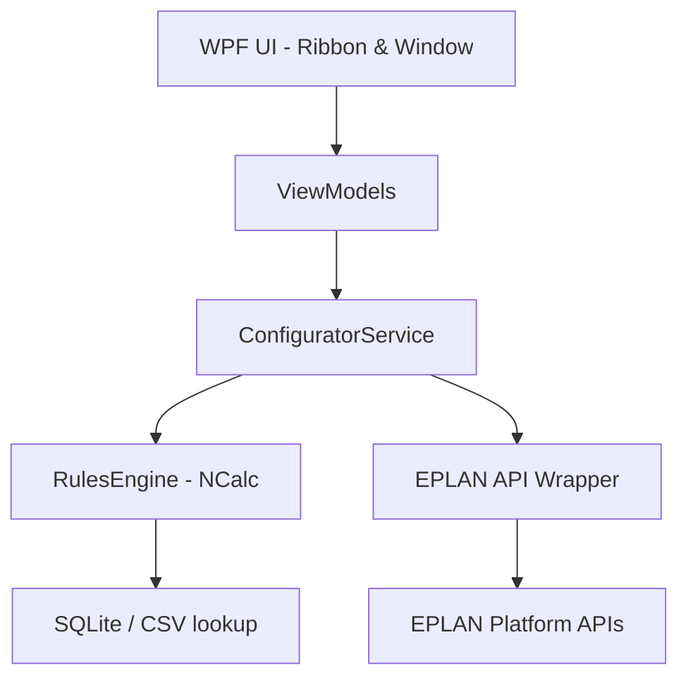

# AutoSchematicConfigurator - System Specification

## 1. System Overview
AutoSchematicConfigurator is an advanced, rule-driven EPLAN automation add-in. Inspired by EPLAN Cogineer and eBuild, it eliminates hardcoded schematics generation logic by employing a generic rule configuration and parsing engine. Engineers define rules via a JSON structure, and the engine dynamically evaluates these rules to build projects, insert page/window macros, resolve locations, and replace placeholder variables.

## 2. Core Concepts (Cogineer Paradigm)
The data model divides schematics design into three distinct levels:
1. **Macro (EMA/EMP)**: The elementary graphic block containing circuits, placeholder objects, and predefined value sets.
2. **Macro-Typical**: A logical grouping of macros representing a functional circuit unit. It defines macro files, active conditions (logical formulas), location mapping, insert coordinates, and variable-to-placeholder assignments.
3. **Typical-Group / Configurator**: The high-level configuration profile shown to the user. It aggregates global user variables (inputs) and controls their propagation down to Macro-Typicals.

---

## 3. System Architecture
The plugin is built using C# and WPF under the MVVM pattern, executing within the EPLAN process space.



### 3.1 Expression Evaluation Rules
Rules and value mapping expressions utilize the NCalc expression library. The expression engine must resolve:
- **Logical Expressions**: `MotorType == 'Direct' && Power_kW <= 15`
- **Ternary Expressions**: `if(Power_kW > 11, '32A', '16A')`
- **String Manipulations**: `Concat([Power_kW], ' kW')`, `Concat('=', CabinetLocation, '+', Cabinet, '-M1')`
- **Mathematical Formulas**: `Round([Power_kW] * 2.0, 1)`, `Ceiling(Current * 1.25)`
- **External Lookups**: `Lookup_Breaker(Power_kW, MotorType)` which queries a SQLite selection database or CSV catalog file to return the exact Value Set name.

### 3.2 EPLAN API Interaction Wrappers
- **Window Macro (.ema)**: Inserted onto existing pages using coordinates.
- **Page Macro (.emp)**: Generates new pages containing page properties and frame designs.
- **Placeholder Value Sets**: Selects predefined value sets (`PlaceHolder.SelectValueSet(setName)`) and directly updates placeholder variables (`PlaceHolder.SetValue(var, val)`), followed by calling `PlaceHolder.Apply()` to redraw elements.
- **Execution Safety**: Execution is wrapped inside an EPLAN `Transaction` and `LockingStep`. Errors trigger automatic rollbacks. Progress is displayed using EPLAN's native `Progress` bar.

---

## 4. Business Workflow

### 4.1 Phase 1: Configuration Definition
1. **Macro Preparation**: Create `.ema`/`.emp` files with Placeholders and Value Sets in EPLAN.
2. **Rule Mapping**: Define Macro-Typical structure, position coordinates, visibility conditions, and parameter mapping rules in the JSON configuration database.
3. **Variable Exposure**: Define input fields (enums, numbers, strings) exposed in the typical group UI.

### 4.2 Phase 2: Execution & Generation
1. **Data Load**: Load UI inputs or external batch data (Excel/REST JSON).
2. **Expression Evaluation**: Parse typical rules using the Rules Engine. Inactive typicals are skipped.
3. **Coordinate & Page Logic**: Calculate coordinates. If target page does not exist, create it.
4. **Drawing Generation**: Initialize transaction, lock UI, insert macros, replace placeholders, apply value sets, and commit.
5. **Post-Process**: Refresh EPLAN project, trigger wire numbering/BOM generation if needed.

---

## 5. JSON Configuration Schema
```json
{
  "ConfiguratorName": "MotorControlCenter",
  "UserVariables": [
    { "Name": "MotorType", "Type": "Enum", "Options": ["Direct", "VFD"], "Default": "Direct" }
  ],
  "MacroTypicals": [
    {
      "Name": "Motor_Main_Circuit",
      "Condition": "MotorType == 'Direct' && Power_kW <= 15",
      "PageStructure": { "HigherLevel": "=MCC", "MountingLocation": "[CabinetLocation]", "PageType": "Circuit" },
      "MacrosToInsert": [
        {
          "MacroPath": "C:\\Macros\\DirectStart.ema",
          "X_Coordinate": "Auto_Next_X",
          "Y_Coordinate": 20.0,
          "PlaceholderValues": {
             "MotorPower": "Concat([Power_kW], ' kW')",
             "ValueSet_Selector": "Lookup_Breaker([Power_kW], 'Direct')"
          }
        }
      ]
    }
  ]
}
```

---

## 6. Verification and Acceptance Criteria
- **Syntax & Compilation**: Code must compile clean against EPLAN DLLs under C# (.NET Framework 4.8).
- **Rule Parser Accuracy**: Complex mathematical, string, and lookup expressions evaluate to correct outputs.
- **EPLAN Integration**: Ribbon registers menu item; WPF forms display properly; schematics pages are generated on-demand; transaction rolls back completely on execution error.
